# Connecting Microsoft Foundry to the Reltio MCP Server

Steps to connect an agent in Microsoft Foundry (formerly Azure AI Foundry)
to the Reltio AgentFlow MCP server, based on Microsoft's documentation,
with screenshots captured while performing the integration.

> **Note on privacy:** tenant IDs, client IDs, secrets, and personal
> identifiers are replaced with placeholders (e.g. `<environment>`).

## How it works

Foundry Agent Service connects to remote MCP servers through the **MCP
tool**. For a server like Reltio's, which signs each user in with OAuth,
Foundry uses **OAuth identity passthrough**:

> "When you use OAuth identity passthrough, Agent Service generates a
> consent link the first time a particular user needs to authorize access.
> After the user signs in and consents, the agent can discover and invoke
> tools on the MCP server with that user's credentials."
>
> Source: [Set up MCP server authentication](https://learn.microsoft.com/en-us/azure/foundry/agents/how-to/mcp-authentication)

Foundry offers **managed OAuth** (the OAuth app is managed by Microsoft or
the MCP server publisher) and **custom OAuth** (you bring your own OAuth
app registration). Reltio uses custom OAuth.

## Prerequisites

From Microsoft's documentation:

- An Azure subscription with an active Microsoft Foundry project.
- The **Foundry User** role on the project to create and test agents, and
  the **Foundry Project Manager** role to create the project connection that
  stores the MCP authentication.
- To use OAuth identity passthrough, people using the agent need at least
  the **Foundry Agent Consumer** role, and their Microsoft Entra tenant must
  match the Foundry project's tenant.

Source: [Connect agents to MCP server endpoints](https://learn.microsoft.com/en-us/azure/foundry/agents/how-to/tools/model-context-protocol)

From Reltio:

- The Reltio MCP server endpoint for your environment:
  `https://<environment>.reltio.com/ai/tools/mcp/`. `<environment>` is the
  Reltio environment your tenant runs on, **not** the tenant ID (see the
  [main guide](../README.md#common-issue-which-endpointurl-do-i-authenticate-against)).
- A **Client ID and secret issued by Reltio** for this integration. Reltio's
  engineering team confirmed that the login page relies on specific
  credentials for identification, and that other credentials won't work.
- Foundry's **redirect URL** added to Reltio's login page allowlist (see
  step 5).

## Steps

### 1. Control test: confirm MCP tools work in your Foundry project

In Copilot Studio, MCP tool creation failed in one environment for reasons
unrelated to Reltio (see [../copilot/README.md](../copilot/README.md)).
Before configuring Reltio, confirm that MCP works in your Foundry project
by adding Microsoft's own public MCP server, which needs no
authentication:

- Server URL: `https://learn.microsoft.com/api/mcp`
- Authentication: unauthenticated

If this succeeds, the project is ready for the Reltio setup.

### 2. Create or open an agent

In the [Foundry portal](https://ai.azure.com), open your project and create
an agent, or open an existing one. After a new project is set up, Foundry
offers **Create an agent** directly.

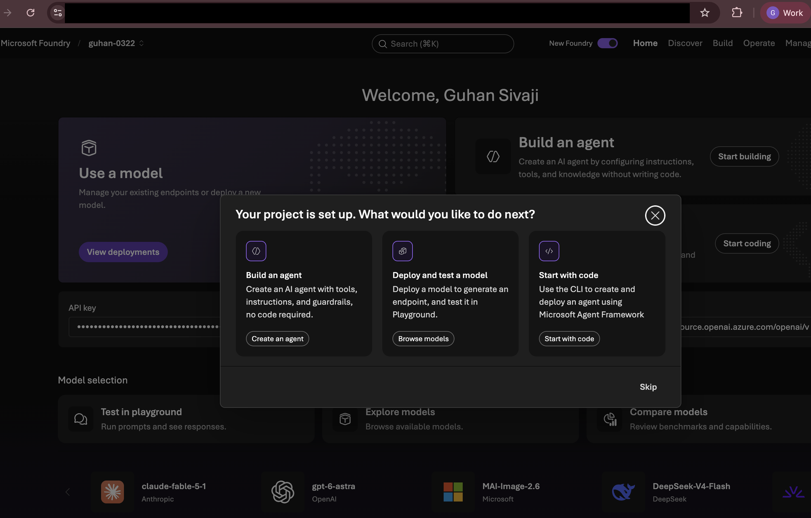

On the **Agents** page, select **New agent → Build an agent**. This opens
the no-code builder, where you set instructions and add tools.

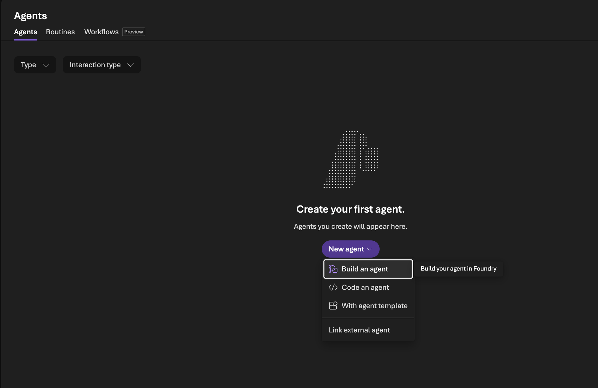

In **Create an agent**, enter a name (e.g. `Reltio-Agentflow-MDM`), keep
**Interaction mode** on **Text** (it can't be changed after the agent is
created, and Voice is in preview), and select **Create agent and open
playground**.

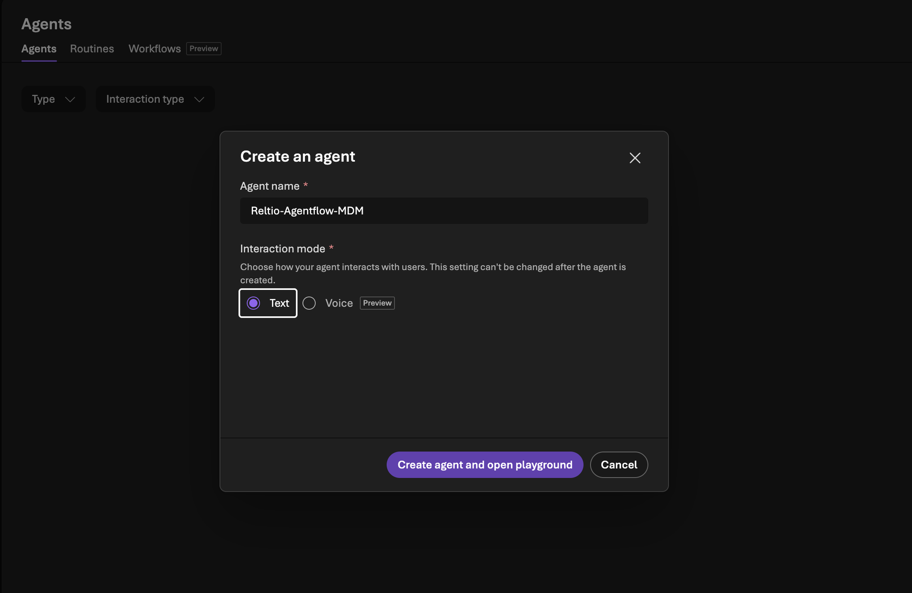

The agent opens in the playground. Before adding the MCP tool:

- **Remove the default Web search tool** (⋮ → remove). Foundry notes that
  web search uses Grounding with Bing and that "customer data will flow
  outside the Azure compliance boundary." Removing it also makes the agent
  answer from Reltio's tools instead of the web.
- **Add instructions** describing the agent's role and scope.

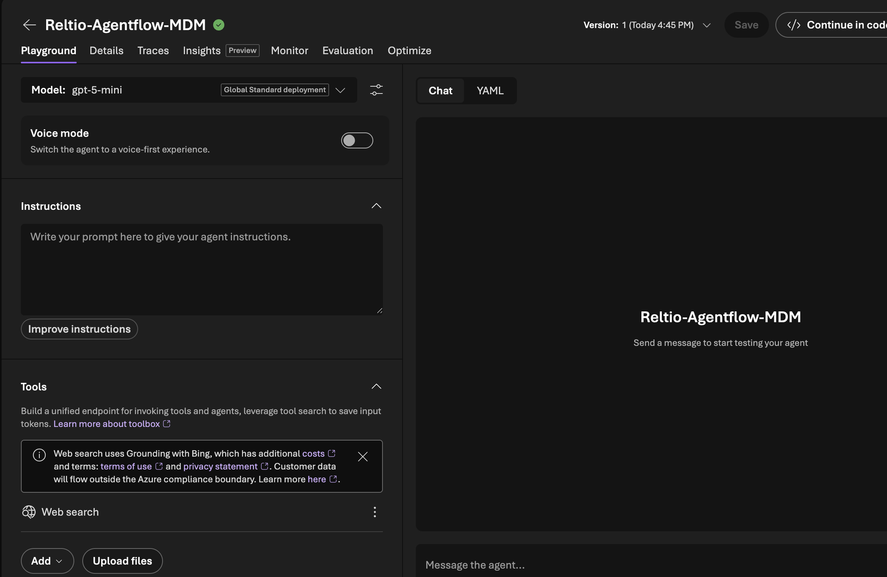

### 3. Add the MCP tool

Select **Save** to keep the instructions, then under **Tools** select
**Add → Add tools** to open the tool catalog.

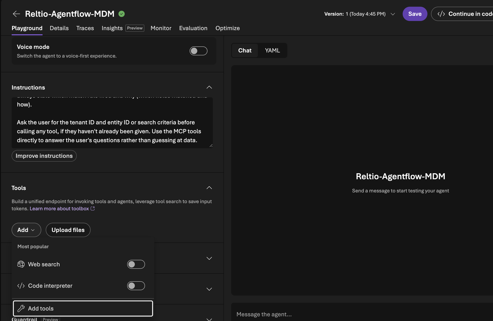

The **Select a tool** dialog has three tabs: **Configured**, **Catalog**,
and **Custom**. MCP servers you connect yourself are under **Custom**.

> **Note:** Foundry warns that "When you connect to non-Foundry tool, your
> customer data may be sent outside the Azure compliance boundary and
> processed according to the applicable terms and data handling policies."
> An external MCP server such as Reltio's counts as a non-Foundry tool.

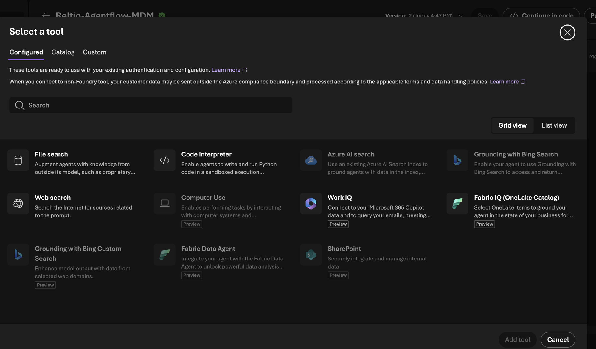

On the **Custom** tab, select **Model Context Protocol (MCP)** ("Give the
agent access to tools hosted on an existing MCP endpoint") and select
**Create**.

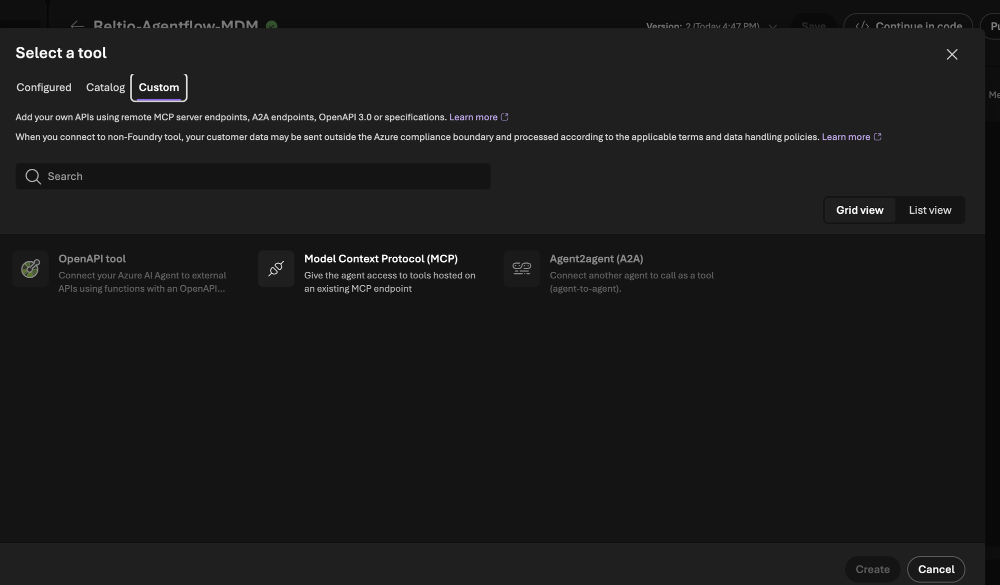
Per Microsoft's documentation: "Connect a tool, go to **Custom**, and then
select **MCP**. Provide a name and MCP server endpoint, and then select
**OAuth Identity Passthrough**."

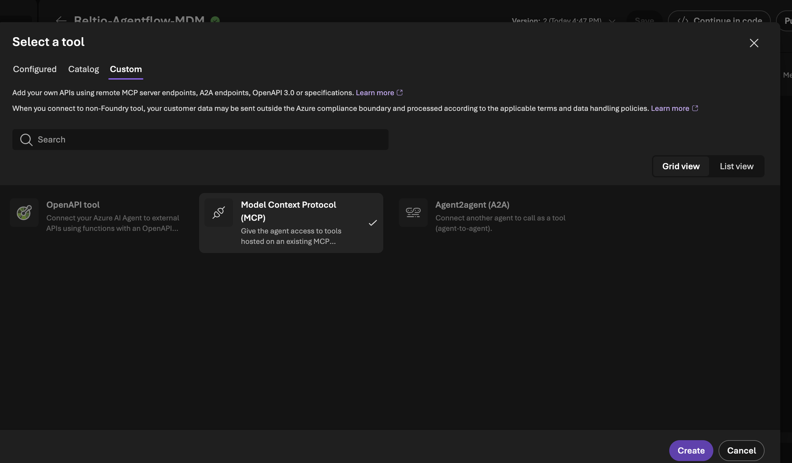

The **Add Model Context Protocol tool** form opens. Fill in:

- **Name**: e.g. `reltio-agentflow`
- **Remote MCP Server endpoint**: `https://<environment>.reltio.com/ai/tools/mcp/`
- **Authentication**: change the default **Key-based** to **OAuth Identity
  Passthrough**

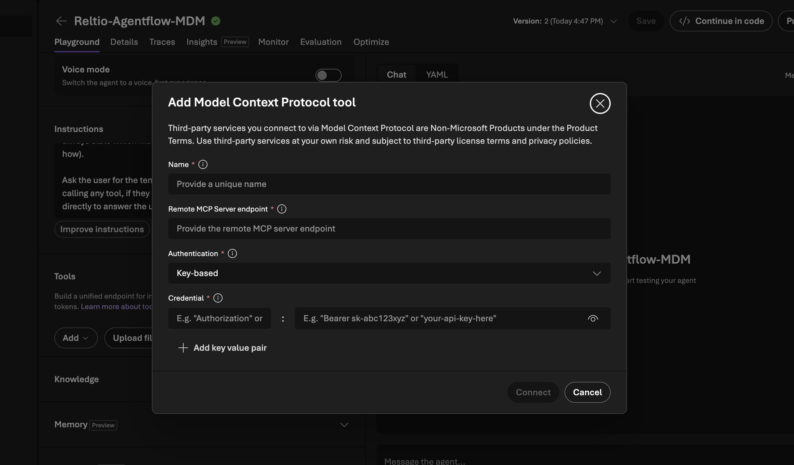

The **Authentication** options are Key-based, OAuth Identity Passthrough,
Microsoft Entra, and Unauthenticated. Choose **OAuth Identity
Passthrough**.

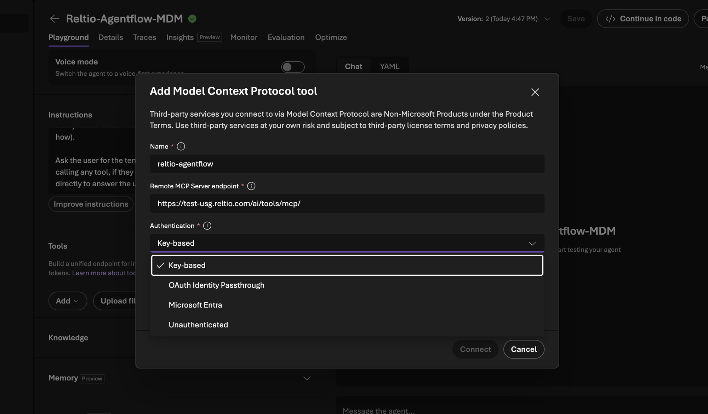

### 4. Configure custom OAuth

Selecting **OAuth Identity Passthrough** shows the OAuth fields directly.
In the current portal, **Client secret** is required and **Refresh URL** is
optional, the reverse of what Microsoft's documentation lists.

| Field | Required in portal | Reltio value |
|---|---|---|
| Client ID | Yes | Issued by Reltio |
| Client secret | Yes | Issued by Reltio |
| Token URL | Yes | `https://login.reltio.com/token` |
| Auth URL | Yes | `https://login.reltio.com` |
| Refresh URL | No | `https://login.reltio.com/token` (Microsoft: "if you don't have a separate refresh URL, you can use the token URL instead") |
| Scopes | No | Cleared for the first attempt (see note) |

**Note on scopes:** Foundry pre-fills `offline_access`, which Microsoft
recommends so tokens refresh automatically. Reltio's OAuth metadata lists
only the `authorization_code` grant and no scopes, so the first attempt
leaves Scopes empty to avoid the login page rejecting an unrecognized
scope.

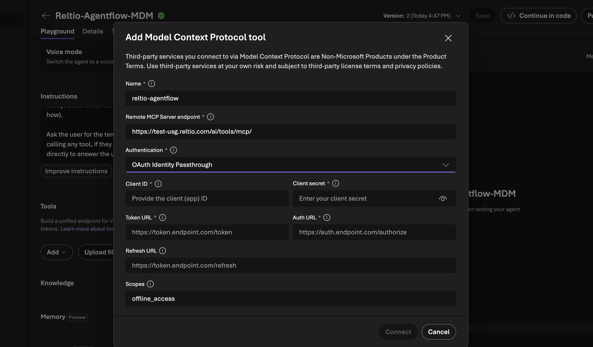

The Auth and Token URLs match the values published in Reltio's OAuth
metadata at
`https://<environment>.reltio.com/ai/tools/.well-known/oauth-authorization-server`.

### 5. Register Foundry's redirect URL with Reltio

> "If you use custom OAuth, you receive a redirect URL after configuration.
> Add the redirect URL to your OAuth app so Agent Service can complete the
> flow."
>
> Source: [Set up MCP server authentication](https://learn.microsoft.com/en-us/azure/foundry/agents/how-to/mcp-authentication)

Selecting **Connect** creates the connection and shows a **"You've created
a credential provider"** dialog with the OAuth redirect URL. Unlike Copilot
Studio in the environment tested earlier, Foundry creates the connection
without error.

The redirect URL is on the same Microsoft domain Copilot Studio uses, with
a unique ID per connector:
`https://global.consent.azure-apim.net/redirect/<connector-id>`

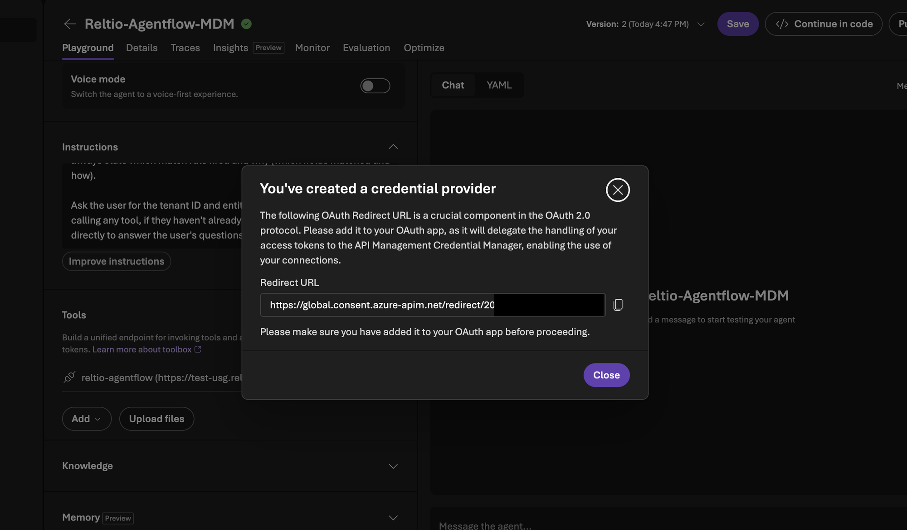

For Reltio, redirect URLs are managed on Reltio's login page allowlist, not
through the Console or the client management API. Reltio's engineering
team has allowlisted Copilot Studio's redirect URIs. If that covers the
whole `global.consent.azure-apim.net` domain, sign-in works as is. If it
lists exact URLs, send this connector's redirect URL to Reltio's AgentFlow
engineering team to add.

### 6. Test the agent

Close the dialog. The tool now appears under **Tools** as
`reltio-agentflow (https://<environment>.reltio.com/ai/tools/mcp/)`.
Select **Save** so the agent version includes the tool.

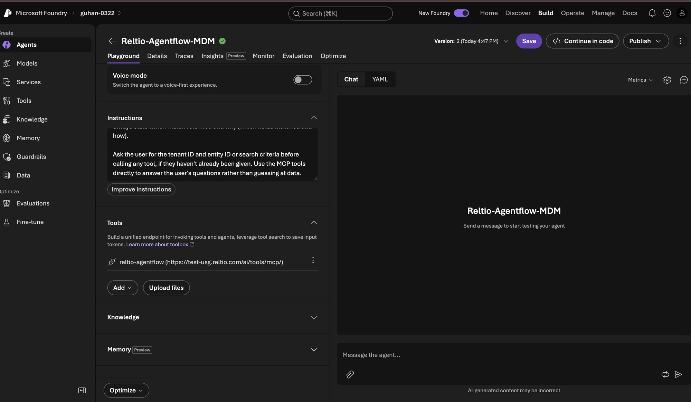

Send a prompt that needs a Reltio tool, for example "List the entity types
configured in Reltio tenant `<tenant-id>`." The first time, the agent
replies with an `oauth_consent_request`: "Sign in to reltio-agentflow in
order to allow the AI agent use reltio-agentflow MCP tool," with an **Open
consent** button.

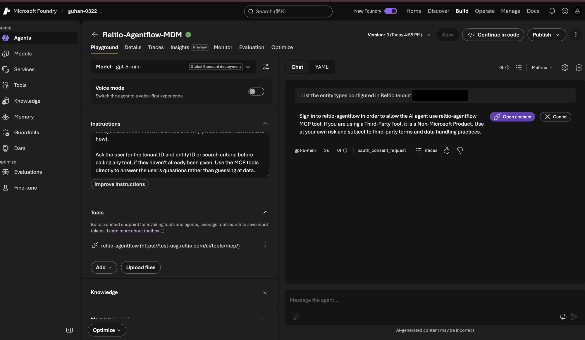

Selecting **Open consent** opens Reltio's sign-in page, which asks for the
tenant and then your Reltio credentials. Reaching this page means Reltio
accepted Foundry's redirect URL (an unaccepted redirect URL goes straight
to Reltio's `redirectUrlNotAllowed` error page instead).

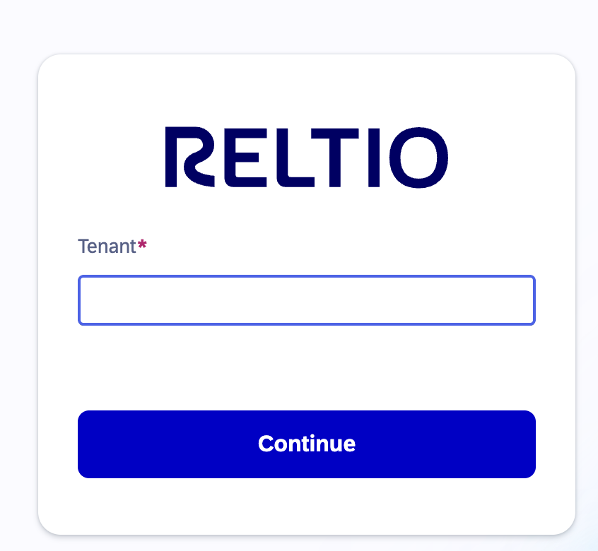

After you sign in to Reltio, Microsoft shows a **Confirmation required**
page. Reaching it confirms Reltio completed the sign-in and redirected back
to Microsoft. The page warns about consent phishing. This request is
legitimate when it says the connection "was created by Microsoft Foundry
Agent Service" and the connection name ends in your tool's name
(`reltio-agentflow`). Check **I have verified this request and trust the
source** and select **Allow access**.

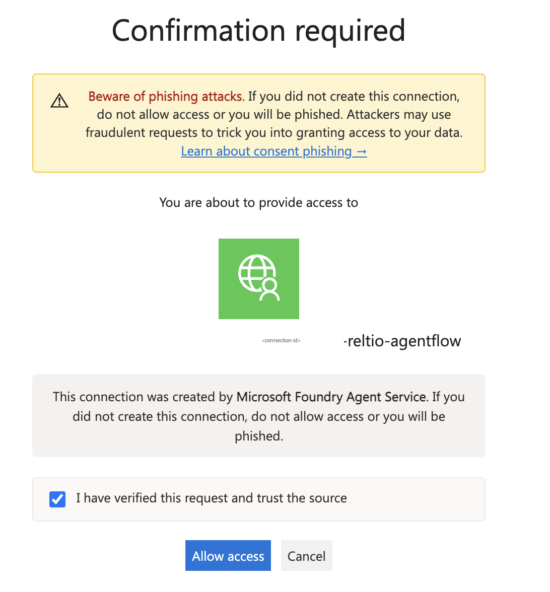

After **Allow access**, Microsoft exchanges the sign-in code for an access
token at the Token URL. In testing, this step failed:

```
OAuth 2 sign in 'OAuth2LoginStrategyCore' failed to exchange code for
access token. Client ID and secret sent in form body.. Response status
code=BadRequest. Response body: {"error":"unauthorized_client",
"error_description":"Invalid credentials"} Client ID and secret sent in
Basic authorization header.. Response status code=BadRequest.
```

Microsoft tried both ways of sending the client secret (form body and
Basic header), and Reltio's token endpoint rejected both, so the secret
format isn't the issue. Reltio's login page keeps its own registry of
OAuth clients, separate from the clients created in Console, and Reltio's
engineering team confirmed that only the credentials they issue work
there. A Console client is valid on Reltio's Authentication API
(`auth.reltio.com`) but is rejected by the login page's token endpoint
(`login.reltio.com/token`). OAuth identity passthrough therefore needs a
client issued by Reltio's AgentFlow team.

## Working alternative: key-based authentication

Reltio's documentation supports getting an access token separately
instead of using the interactive flow: "If you're using a different
authentication method, like the client credentials flow, you can get an
access token separately and start using MCP tools right away."
([Authentication flow for the AgentFlow MCP Server](https://docs.reltio.com/en/developer-resources/ai-integrations/reltio-model-context-protocol-mcp-server-at-a-glance/authentication-flow-for-the-agentflow-mcp-server))

Foundry then sends that token on every call as a fixed header.

### A. Create a Console client for the client credentials grant

In Reltio Console, under **Client Credentials**, create a client (or edit
one) with:

- **Authorization Grant Type**: Client Credentials
- **Roles**: `ROLE_EXECUTE_MCP` and `ROLE_API`, each **assigned to your
  tenant** (an empty Tenant column means the roles don't apply to any
  tenant's data)

A client created with the Authorization Code grant returns
`Unauthorized grant type: client_credentials` when used this way.

### B. Get an access token and verify it

Run this in your own terminal so the client secret stays out of shared
logs:

```bash
read -s -p "Client secret: " CS; echo
TOKEN=$(curl -s -u "<client-id>:$CS" -X POST https://auth.reltio.com/oauth/token \
  -d grant_type=client_credentials | python3 -c 'import sys,json;print(json.load(sys.stdin)["access_token"])')

# Verify the MCP server accepts it (expect "status: 200")
curl -s -o /dev/null -w "status: %{http_code}\n" -X POST \
  https://<environment>.reltio.com/ai/tools/mcp/ \
  -H "Authorization: Bearer $TOKEN" -H "Content-Type: application/json" \
  -H "Accept: application/json, text/event-stream" \
  -d '{"jsonrpc":"2.0","id":1,"method":"initialize","params":{"protocolVersion":"2025-06-18","capabilities":{},"clientInfo":{"name":"test","version":"1"}}}'
```

In testing, `initialize` returned `200` from `Reltio-MCP-Service`, and
`tools/list` returned 114 tools.

### C. Add the MCP tool with key-based authentication

Add the MCP tool as in step 3, but with:

- **Authentication**: Key-based
- **Credential**: name `Authorization`, value `Bearer <access token>`

No consent step is needed. Select **Connect**, then **Save**.

### D. Test

Ask the agent a question that needs a Reltio tool. Foundry lists the
server's tools (`mcp_list_tools`), the agent picks a tool, and, because
`require_approval` defaults to `always`, Foundry asks you to approve the
call. Choose **Approve once** or **Always approve this tool**. Avoid
**Always approve all tools**, since Reltio's tools include ones that
change data (merge, unmerge, delete, update).

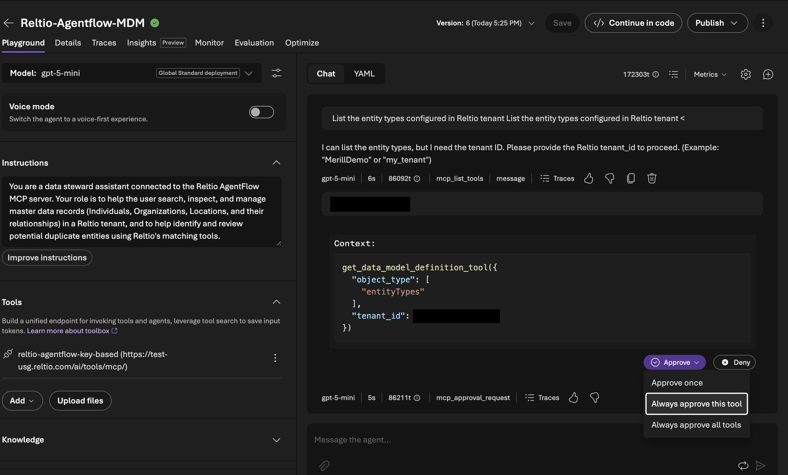

After approval, the agent calls Reltio and answers with live data from the
tenant:

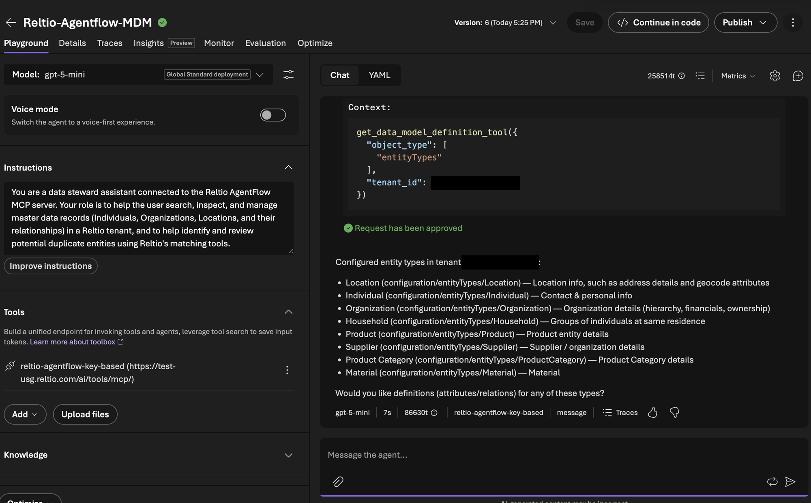

### Trade-offs of key-based authentication

- **Tokens expire.** Reltio access tokens are valid for 3,600 seconds by
  default, after which the token in the connection must be replaced. Fine
  for testing and demos, not for production.
- **Shared identity.** Every user of the agent acts as the same client;
  there's no per-user sign-in or user context.
- **Visible to project members.** Microsoft notes that people with access
  to the project can read an API key stored in a project connection.
- **Token cost.** Listing Reltio's full tool set adds roughly 86,000 input
  tokens per response. Limiting the agent to the tools it needs (for
  example with `allowed_tools`, or a Foundry toolbox) reduces this.

OAuth identity passthrough, with a client issued by Reltio's AgentFlow
team, remains the recommended setup for production.

## Screenshots

Screenshots are added inline next to each step as the integration is
performed.
